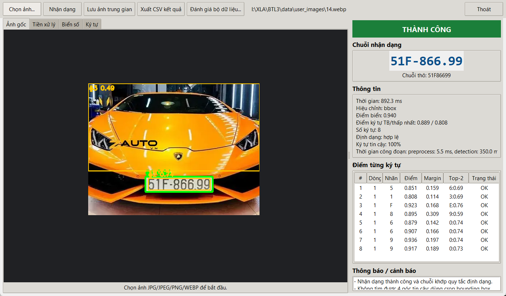
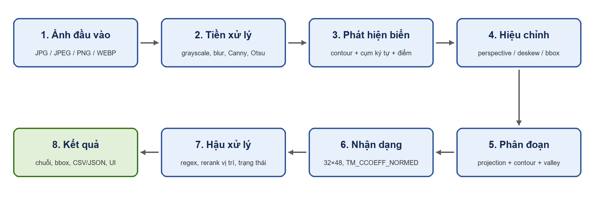
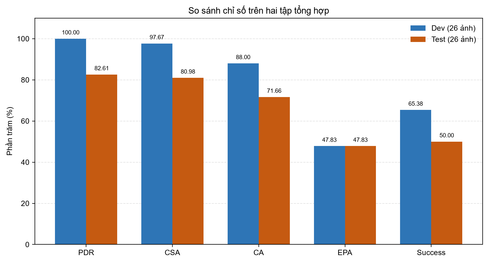

# Nhận dạng biển số xe Việt Nam bằng xử lý ảnh truyền thống

Đồ án xây dựng hệ thống nhận dạng biển số xe Việt Nam bằng **Python + OpenCV**,
chỉ dùng các kỹ thuật xử lý ảnh cổ điển và **Template Matching**. Hệ thống
không dùng học máy/học sâu, không dùng YOLO, KNN, SVM, OCR học sẵn hay API
nhận dạng bên ngoài.

**Nhóm thực hiện:**

| Họ và tên | MSSV | Vai trò |
|---|---|---|
| Nguyễn Đình Khải | B23DCCN420 | Nhóm trưởng — kiến trúc, phát hiện biển, hiệu chỉnh |
| Nguyễn Trung Tường | B23DCCN909 | Phân đoạn ký tự, nhận dạng template, hậu xử lý |
| Bùi Văn Đạt | B23DCCN126 | Tiền xử lý, giao diện, đánh giá, kiểm thử, báo cáo |

Chi tiết phân công: [`docs/PHAN_CONG.md`](docs/PHAN_CONG.md).
Tài liệu ôn tập: [`docs/README.md`](docs/README.md).

> **Trạng thái và kết quả đo trung thực**
>
> - Mã nguồn, giao diện, bộ kiểm thử và báo cáo đã hoàn thành.
> - **Ảnh thật do người dùng cung cấp:** 13 ảnh split `user` đạt **13/13
>   chuỗi chính xác, tất cả `SUCCESS`**; ảnh đặc biệt `8.jpg` đạt **1/1**.
>   Đây là kết quả sau khi dùng chính 14 ảnh này để tinh chỉnh, **không phải
>   holdout độc lập**.
> - Tập **test tổng hợp** (23 ảnh có biển, 3 ảnh không biển):
>   **PDR 82.61%, Detection Precision 100%, CSA 80.98%, CA 71.66%,
>   EPA 47.83% (11/23), 1.36 s/ảnh**.
> - Tập **dev tổng hợp**: **PDR 100%, Detection Precision 100%, CSA 97.67%,
>   CA 88.00%, EPA 47.83% (11/23), 1.50 s/ảnh**.
> - **Chưa đạt mục tiêu tham chiếu EPA ≥ 70%** trên tập tổng hợp. Nguyên nhân
>   và giới hạn được phân tích trong `reports/REPORT.md`.
> - Ảnh thật chưa có box biển/ký tự trong nhãn, nên PDR/CSA trên split `user`
>   là proxy theo sự hiện diện và số lượng, không phải IoU. Không dùng các
>   con số này để tuyên bố hệ thống đã sẵn sàng triển khai.

## Giao diện



---

## 1. Chức năng

- Đọc ảnh **JPG/JPEG/PNG/WEBP**, kiểm tra ảnh hợp lệ và chuẩn hóa kích thước.
- Phát hiện vùng biển số bằng cạnh, morphology, contour và đặc trưng hình học.
- Hiệu chỉnh phối cảnh (perspective), deskew hoặc fallback bounding box.
- Phân đoạn ký tự cho biển **một dòng** và **hai dòng**.
- Chuẩn hóa ký tự về cùng kích thước, nhận dạng bằng Template Matching.
- Ghép chuỗi, kiểm tra định dạng, từ chối kết quả không đủ tin cậy.
- Giao diện Tkinter: chọn ảnh, xem ảnh trung gian, xem ký tự, xuất CSV.
- CLI: nhận dạng một ảnh, nhận dạng hàng loạt, đánh giá có nhãn.
- Sinh báo cáo đánh giá CSV/JSON/Markdown.
- Bộ kiểm thử pytest cho từng module và pipeline end-to-end (**78 test**).

## 2. Cấu trúc dự án

```text
.
├── main.py                     # CLI chính
├── config.yaml                 # Toàn bộ tham số tập trung
├── requirements.txt
├── README.md
├── src/
│   ├── config.py               # Dataclass cấu hình, load/save YAML
│   ├── io_utils.py             # Đọc/ghi ảnh Unicode, hình học, IoU
│   ├── preprocessing.py        # Resize, gray, blur, CLAHE, Canny, threshold
│   ├── plate_detection.py      # Sinh và xếp hạng ứng viên biển số
│   ├── plate_rectification.py  # Perspective / deskew / bbox
│   ├── character_segmentation.py
│   ├── character_recognition.py# Chuẩn hóa + Template Matching
│   ├── postprocessing.py       # Ghép chuỗi, validate, quyết định trạng thái
│   ├── evaluation.py           # PDR, Precision/Recall, CSA, CA, EPA
│   └── pipeline.py             # Điều phối toàn bộ pipeline
├── ui/
│   └── app.py                  # Giao diện Tkinter
├── tools/
│   ├── build_templates.py      # Sinh template từ font hệ thống
│   ├── build_synthetic_dataset.py
│   ├── build_report_docx.py    # Sinh báo cáo Word
│   └── diagnose_*.py           # Công cụ chẩn đoán khi phát triển
├── data/
│   ├── templates/<label>/      # Template ký tự
│   ├── samples/                # 52 ảnh tổng hợp + README
│   ├── labels.csv              # Nhãn biển và box từng ký tự (tổng hợp)
│   ├── user_images/            # 14 ảnh thật do người dùng cung cấp
│   ├── user_labels.csv         # Nhãn chuỗi cho ảnh thật (chưa có box)
│   └── synthetic_manifest.json
├── tests/                      # 78 test pytest
├── docs/                       # Tài liệu học tập và phân công
├── reports/                    # Báo cáo DOCX/PDF/Markdown và hình
└── results/                    # CSV/JSON/Markdown kết quả đánh giá
```

## 3. Cài đặt

Yêu cầu:

- Python **3.11+** (đã kiểm thử với Python 3.13.6 trên Windows).
- Windows có Tk/Tcl nếu muốn dùng giao diện.
- Các gói trong `requirements.txt`:
  `opencv-python`, `numpy`, `PyYAML`, `Pillow`, `pytest`.

```powershell
cd vietnamese-license-plate-recognition
python -m venv .venv
.venv\Scripts\Activate.ps1
python -m pip install --upgrade pip
python -m pip install -r requirements.txt
python main.py info
```

Nếu PowerShell chặn script kích hoạt, có thể dùng trực tiếp
`.venv\Scripts\python.exe` thay cho `python`.

## 4. Sử dụng

### 4.1. Giao diện Tkinter

```powershell
python main.py ui
```

Giao diện cho phép:

- Chọn ảnh JPG/JPEG/PNG/WEBP.
- Nhận dạng và xem trạng thái, chuỗi kết quả, điểm tin cậy.
- Xem ảnh gốc, ảnh tiền xử lý, ảnh biển đã hiệu chỉnh, nhị phân và ký tự.
- Lưu ảnh trung gian.
- Xuất kết quả hiện tại ra CSV.
- Chạy đánh giá trên tập dữ liệu có nhãn.

### 4.2. Nhận dạng một ảnh

```powershell
python main.py recognize data\samples\dev_clear_001.jpg
python main.py recognize data\samples\dev_clear_001.jpg --json
python main.py recognize data\samples\dev_clear_001.jpg --save-debug
python main.py recognize data\samples\dev_clear_001.jpg --output-csv results\one_result.csv
```

Mã thoát: `0` nếu `SUCCESS` hoặc `FORMAT_WARNING`; `2` nếu bị từ chối
(`LOW_CONFIDENCE`, `PLATE_NOT_FOUND`, `INVALID_IMAGE`, `CONFIG_ERROR`).

### 4.3. Đánh giá trên bộ nhãn

```powershell
# Dev: dùng để phát triển/tham khảo
python main.py evaluate --split dev `
  --output-csv results\dev_evaluation.csv `
  --summary-json results\dev_summary.json `
  --summary-md results\dev_summary.md

# Test: chỉ chạy sau khi đã cố định cấu hình
python main.py evaluate --split test `
  --output-csv results\test_evaluation.csv `
  --summary-json results\test_summary.json `
  --summary-md results\test_summary.md

# Ảnh thật do người dùng cung cấp (nhãn chuỗi, chưa có box)
python main.py evaluate --split user `
  --labels data\user_labels.csv --samples-dir data\user_images `
  --output-csv results\user_final.csv `
  --summary-json results\user_final_summary.json `
  --summary-md results\user_final_summary.md

python main.py evaluate --split special `
  --labels data\user_labels.csv --samples-dir data\user_images `
  --output-csv results\user_special_final.csv `
  --summary-json results\user_special_final_summary.json `
  --summary-md results\user_special_final_summary.md
```

Có thể chạy nhanh bằng `run_user_eval.bat` (đánh giá ảnh thật) hoặc
`run_user_batch.bat` (nhận dạng hàng loạt ảnh thật).

Lưu ý: nếu không truyền `--output-csv`/`--summary-json`, chương trình dùng
đường dẫn mặc định trong `config.yaml` và có thể ghi đè kết quả của lần chạy
trước.

### 4.4. Nhận dạng hàng loạt

```powershell
python main.py batch data\samples --output-csv results\batch_results.csv
```

### 4.5. Thông tin cấu hình và template

```powershell
python main.py info
```

## 5. Pipeline xử lý



1. **Tiền xử lý** (`preprocessing.py`)
   - Đọc ảnh an toàn với đường dẫn Unicode (`np.fromfile` + `cv2.imdecode`).
   - Giới hạn cạnh dài 1600 px, cạnh nhỏ tối thiểu 40 px.
   - Grayscale, Gaussian blur, CLAHE tùy chọn, Canny, Otsu/adaptive threshold.
2. **Phát hiện biển** (`plate_detection.py`)
   - Tạo nhiều bản đồ morphology từ cạnh và vùng mực.
   - Sinh ứng viên từ contour, contour xấp xỉ tứ giác và tổ hợp.
   - Chấm điểm theo tỷ lệ (mục tiêu 4.6 và 1.45), diện tích, mật độ cạnh,
     độ đầy và text-likeness.
   - Loại ứng viên không có bằng chứng ký tự, gộp trùng lặp, giữ top 5.
3. **Hiệu chỉnh** (`plate_rectification.py`)
   - Crop có padding: 10% ngang, 6% chiều rộng theo trục dọc.
   - Tìm tứ giác bằng Canny, fallback `minAreaRect`; nếu không có thì deskew
     hoặc dùng bounding box.
4. **Phân đoạn ký tự** (`character_segmentation.py`)
   - Resize biển về rộng 640 px, tăng tương phản, threshold tự động.
   - Chuẩn hóa cực tính để ký tự là foreground.
   - Xóa viền biển, ốc vít, gạch phân cách và nhiễu nhỏ.
   - Tách dòng bằng projection ngang; tách ký tự bằng contour + projection dọc.
   - Tách các box quá rộng, lọc hình học, sắp xếp theo thứ tự đọc.
   - Biển chuẩn 7–9 ký tự; biển đặc biệt 10 ký tự chỉ được chấp nhận khi
     hai dòng cân bằng (ví dụ 5/5), tránh ghép mảnh nhiễu ở mép.
5. **Nhận dạng** (`character_recognition.py`)
   - Chuẩn hóa mỗi ký tự về canvas **32×48**, kéo giãn ink box (`stretch`).
   - `cv2.matchTemplate` với `TM_CCOEFF_NORMED`, làm mờ σ = 2.0 để giảm nhạy
     cảm với độ dày nét và lệch căn chỉnh.
   - Hai tầng: chấm nhanh trên template đại diện, sau đó chấm đầy đủ cho
     các nhãn tốt nhất.
   - Loại các nhãn không hợp lệ trên biển Việt Nam khỏi điểm số:
     `I, J, O, Q, W`.
   - Prior số lỗ (hole prior) giúp phân biệt `6/B`, `0/D`, `8/B`; biến thể
     chữ `4` hở đỉnh được thêm thủ công cho font biển thật.
   - Từ chối ký tự khi điểm thấp hoặc khoảng cách top-1/top-2 quá nhỏ.
6. **Hậu xử lý** (`postprocessing.py`)
   - Ghép chuỗi theo thứ tự đọc; ký tự chưa chắc chắn giữ `?`.
   - Kiểm tra định dạng `2 số + 1–2 chữ + 4–6 số`.
   - Rerank theo kiểu ký tự tại từng vị trí, chỉ chọn trong các ứng viên
     template đã chấm điểm; không tạo ký tự mới.
   - **Không tự sửa ký tự** và không đổi ký tự chỉ để chuỗi trông hợp lệ.
   - Quyết định `SUCCESS`, `FORMAT_WARNING`, `LOW_CONFIDENCE`.
7. **Đánh giá** (`evaluation.py`)
   - PDR theo IoU box biển, Precision/Recall có tính ảnh không biển.
   - CSA theo IoU từng box ký tự (nếu nhãn có `char_boxes`).
   - CA bằng căn chỉnh Levenshtein; EPA theo chuỗi chuẩn hóa.
   - Thời gian trung bình theo từng công đoạn; CSV/JSON/Markdown.

## 6. Template và dữ liệu

### 6.1. Template

- 36 nhãn: `0–9`, `A–Z` (trừ các nhãn bị loại khỏi điểm số khi nhận dạng).
- 15 font Windows × 3 biến thể (`normal`, `thick`, `thin`) × 36 nhãn
  = **1.620 template thô**.
- Khi nạp, hệ thống khử template gần trùng và thêm 45 biến thể chữ `4` hở
  đỉnh: còn **1.550 template đầy đủ** và **216 template coarse** (6 nhãn đại
  diện mỗi ký tự).
- Template được **render từ font**, không phải ảnh chụp ký tự thật. Đây là
  giới hạn lớn về miền dữ liệu; khi dùng thật nên bổ sung ảnh crop ký tự đã
  xác minh vào `data/templates/<label>/`.

Sinh lại template:

```powershell
python tools\build_templates.py
# hoặc xóa và sinh lại:
python tools\build_templates.py --clean
```

### 6.2. Bộ dữ liệu tổng hợp

- Tổng cộng **52 ảnh**, chia `dev` 26 và `test` 26.
- Mỗi split: 23 ảnh có biển, 3 ảnh không biển.
- Loại biển: 19 một dòng, 4 hai dòng, 3 không biển (mỗi split).
- Điều kiện mỗi split: 5 rõ, 4 nghiêng, 4 hai dòng, 3 thiếu sáng,
  3 ký tự dính, 3 chất lượng thấp, 3 không biển, 1 độ phân giải thấp.
- Nhãn gồm box biển, box từng ký tự và metadata trong `data/labels.csv`;
  `data/synthetic_manifest.json` lưu thông tin sinh ảnh.

Sinh lại dữ liệu tổng hợp:

```powershell
python tools\build_synthetic_dataset.py --clean
```

Generator cố ý dùng font mẫu khác với font sinh template (Calibri, Verdana,
Times New Roman, Trebuchet) để tránh việc template "học thuộc" đúng font của
ảnh kiểm thử. Đổi lại, bài toán khó hơn nhiều và phản ánh đúng giới hạn của
Template Matching khi font lạ.

### 6.3. Ảnh thật do người dùng cung cấp

- `data/user_images/` chứa **14 ảnh thật**: 13 ảnh biển Việt Nam thông thường
  (một dòng và hai dòng, xe máy và ô tô) và `8.jpg` là biển đặc biệt
  `17MD799999`.
- `data/user_labels.csv` chứa nhãn chuỗi đã được xác minh thủ công, cùng
  `split` (`user`/`special`) và mô tả điều kiện.
- Nhãn hiện **chưa có box biển và box ký tự**, nên các chỉ số PDR/CSA trên
  tập này chỉ là proxy theo sự hiện diện và số lượng; không phải IoU.
- Toàn bộ 14 ảnh đã được dùng để tinh chỉnh tham số. Vì vậy 14/14 không phải
  kết quả trên holdout độc lập.

## 7. Kết quả đo

Cấu hình cuối cùng: `config.yaml`, SHA-256
`69C7570BD94D24B9307D711B88C6E1B415DFB28A772A10A8C75D038CACA59DDA`.
Thời gian đo trên máy phát triển; không phải benchmark tối ưu.



### 7.1. Ảnh thật — split `user` (13 ảnh)

| Chỉ số | Giá trị |
|---|---:|
| Plate Detection Rate (proxy) | 100.00% |
| Detection Precision | 100.00% (TP=13, FP=0, FN=0, TN=0) |
| Detection Recall (proxy) | 100.00% |
| Character Segmentation Accuracy (count proxy) | 100.00% |
| Character Accuracy | 100.00% |
| Exact Plate Accuracy | 100.00% (13/13) |
| Thời gian trung bình | 1863.94 ms |
| Success Rate | 100.00% (13/13) |
| Trạng thái | SUCCESS 13 |

`8.jpg` (split `special`, biển `17MD799999`) đạt **1/1 chuỗi chính xác**,
trạng thái `SUCCESS`, thời gian 17.8 s do ảnh lớn và nhiều ứng viên.

**Cảnh báo diễn giải:** 13 ảnh này đã được dùng để tinh chỉnh, không phải
holdout độc lập. Nhãn chưa có box biển/ký tự nên PDR và CSA là proxy theo
sự hiện diện và số lượng, không phải IoU.

### 7.2. Tập dev tổng hợp (26 ảnh)

| Chỉ số | Giá trị |
|---|---:|
| Plate Detection Rate | 100.00% |
| Detection Precision | 100.00% (TP=23, FP=0, FN=0, TN=3) |
| Detection Recall | 100.00% |
| Character Segmentation Accuracy | 97.67% |
| Character Accuracy | 88.00% |
| Exact Plate Accuracy | 47.83% (11/23) |
| Thời gian trung bình | 1498.09 ms |
| Success Rate | 65.38% (17/26) |
| Failure/Rejection Rate | 26.92% |
| Trạng thái | SUCCESS 17, FORMAT_WARNING 2, LOW_CONFIDENCE 4, PLATE_NOT_FOUND 3 |

### 7.3. Tập test tổng hợp (26 ảnh)

| Chỉ số | Giá trị |
|---|---:|
| Plate Detection Rate | 82.61% |
| Detection Precision | 100.00% (TP=19, FP=0, FN=4, TN=3) |
| Detection Recall | 82.61% |
| Character Segmentation Accuracy | 80.98% |
| Character Accuracy | 71.66% |
| Exact Plate Accuracy | 47.83% (11/23) |
| Thời gian trung bình | 1358.76 ms |
| Success Rate | 50.00% (13/26) |
| Failure/Rejection Rate | 42.31% |
| Trạng thái | SUCCESS 13, LOW_CONFIDENCE 9, FORMAT_WARNING 2, PLATE_NOT_FOUND 2 |

Ghi chú về mẫu số: EPA trong bảng tính trên **23 ảnh có biển**. Nếu chia cho
toàn bộ 26 ảnh theo đúng công thức `N_test_images` của đặc tả, EPA là
**42.31% (11/26)** ở cả dev và test. CSA là trung bình tỷ lệ box ký tự ghép
đúng (IoU ≥ 0.5) theo từng ảnh; nếu đếm gộp, dev đạt 171/175 = 97.71% và
test đạt 152/187 = 81.28%.

Chi tiết từng ảnh, phân tích lỗi và các thực nghiệm bị loại nằm trong
[`reports/REPORT.md`](reports/REPORT.md).

## 8. Cấu hình

Toàn bộ tham số nằm trong `config.yaml`; `src/config.py` ánh xạ sang dataclass
và kiểm tra tính hợp lệ cơ bản. Có thể ghi đè khi thực nghiệm:

```python
from src.config import load_config

cfg = load_config(overrides={"recognition.coarse_top_labels": 10})
```

Các nhóm tham số chính:

| Nhóm | Tham số tiêu biểu | Giá trị hiện tại |
|---|---|---|
| `image` | `max_side`, `min_side`, phần mở rộng | 1600, 40, `.jpg/.jpeg/.png/.webp` |
| `preprocessing` | blur, Canny, threshold | Gaussian 5×5, Canny 60/180, Otsu |
| `detection` | kernel, tỷ lệ, ngưỡng | close 17×3; ratio 1.1–7.0; score ≥ 0.45 |
| `rectification` | padding, deskew | 0.10 ngang, 0.06 dọc theo chiều rộng |
| `segmentation` | width, threshold, row | 640 px, auto, 7–9 ký tự; 10 nếu hai dòng cân bằng |
| `recognition` | method, threshold, top-k | `TM_CCOEFF_NORMED`, score ≥ 0.60, margin ≥ 0.035 |
| `postprocessing` | pattern, confidence | 2 số + 1–2 chữ + 4–6 số; mean ≥ 0.60 |
| `evaluation` | IoU | 0.50 |

Không nên sửa tham số chỉ để làm đẹp kết quả trên tập test. Nếu đánh giá trên
ảnh thật, hãy tạo tập nhãn mới và giữ test độc lập.

## 9. Kiểm thử

```powershell
python -m pytest -q
```

Kết quả lần chạy cuối: **78 passed**. Workflow [`.github/workflows/tests.yml`](.github/workflows/tests.yml)
chạy lại toàn bộ kiểm thử trên GitHub Actions mỗi khi push lên `main`. Bộ test
bao phủ:

- Đọc/ghi ảnh, cấu hình, override, lỗi cấu hình.
- Tiền xử lý, ảnh quá nhỏ/không tồn tại, resize.
- Phát hiện biển, cắt ứng viên, đếm thành phần giống ký tự.
- Hiệu chỉnh phối cảnh và ánh xạ ngược tọa độ.
- Phân đoạn biển một dòng/hai dòng tổng hợp; biển 10 ký tự cân bằng.
- Template library, nhận dạng template, từ chối ký tự rỗng.
- Prior số lỗ, biến thể chữ `4` hở đỉnh, rerank theo vị trí.
- Ghép chuỗi, validate định dạng 7–10 ký tự, quyết định trạng thái, không tự sửa ký tự.
- Ứng viên cụm chữ và gắn hộp hình học (bbox hint) để báo cáo vị trí.
- Pipeline end-to-end, ảnh không biển, lỗi template, lưu debug.
- Đánh giá, căn chỉnh Levenshtein, xuất CSV/JSON/Markdown.
- Smoke test Tkinter trong tiến trình con (tự bỏ qua nếu không có Tk/display).

## 10. Giới hạn đã biết

1. **14 ảnh thật không phải holdout độc lập.** Toàn bộ 14 ảnh đã được dùng
   để tinh chỉnh segmentation/recognition; 13/13 và 1/1 chỉ là kết quả hồi quy
   trên tập đã biết, không phải độ chính xác tổng quát.
2. **Chưa có box biển/ký tự cho ảnh thật.** PDR/CSA trên split `user` là proxy
   theo sự hiện diện và số lượng, không phải IoU; chưa thể kết luận vị trí
   biển được phát hiện chính xác đến đâu.
3. **Chưa đạt EPA ≥ 70%** của đặc tả trên tập tổng hợp. Trên test, EPA là
   47.83% (11/23).
4. **Template từ font, không phải crop thật.** Font mẫu khác font template
   gây nhầm lẫn các cặp tương tự: `S/5`, `B/8`, `2/Z`, `1/T`, `0/D`.
5. **Tập test tổng hợp không hoàn toàn bị khóa.** Trước khi cố định cấu hình,
   hai ảnh `test_clear_001` và `test_no_plate_001` đã được xem để chẩn đoán.
   Kết quả test không phải đánh giá mù hoàn toàn.
6. **Từ chối bảo thủ.** Hệ thống ưu tiên `LOW_CONFIDENCE` với `?` thay vì
   đoán; nhiều kết quả đúng top-1 vẫn bị từ chối. Đây là lựa chọn có chủ ý,
   không phải lỗi ghép chuỗi.
7. **Phân đoạn ký tự dính còn yếu.** Các ảnh `touching` thường thiếu ký tự
   hoặc tách sai; `test_touching_001/002/003` chỉ còn 1–5 box.
8. **Hiệu chỉnh phối cảnh chưa hoàn hảo.** Một số ảnh nghiêng mạnh bị cắt góc
   hoặc chọn tứ giác bao vùng nền; thực nghiệm bright-quad đã bị loại vì làm
   giảm kết quả tổng thể.
9. **Trạng thái chưa gọn trong vài trường hợp.** Ảnh không biển
   `test_no_plate_003` trả `LOW_CONFIDENCE` không có box thay vì
   `PLATE_NOT_FOUND`.
10. **Thời gian chưa tối ưu.** Trung bình 1.36–1.50 s/ảnh trên tập tổng hợp
    trong lần đo cuối; `8.jpg` mất khoảng 17.8 s. Thời gian dao động theo tải
    máy và số ứng viên; template load lúc khởi động khoảng 1.4 s.
11. **Giao diện mới được smoke test**, chưa được kiểm thử thủ công toàn bộ
    luồng với nhiều ảnh thật.
12. **Kích thước mẫu nhỏ.** 13 ảnh thật thông thường và 52 ảnh tổng hợp không
    đủ để ước lượng khoảng tin cậy hẹp cho các chỉ số.

## 11. Hướng phát triển

- Bổ sung **ảnh crop ký tự thật đã xác minh** vào template library; đánh giá
  lại trên bộ ảnh thật độc lập.
- Cải thiện phân đoạn ký tự dính bằng projection/profile và watershed cổ điển
  (không dùng học máy).
- Cải thiện hiệu chỉnh phối cảnh cho biển nghiêng mạnh, kiểm tra tứ giác chạm
  biên ROI.
- Thêm nhiều định dạng biển (xe máy, biển đặc biệt) và kiểm thử với ảnh thật.
- Tối ưu tốc độ: giảm số template, cache template đã chuẩn hóa, song song hóa
  theo ứng viên.
- Xây dựng bộ test hồi quy trên ảnh thật có nhãn; khóa test trước khi tinh
  chỉnh tham số.

## 12. Tài liệu và kết quả kèm theo

- [`docs/README.md`](docs/README.md): mục lục tài liệu học tập và lộ trình ôn.
- [`docs/PHAN_CONG.md`](docs/PHAN_CONG.md): phân công thành viên và tiến độ.
- `docs/on-tap/`: tài liệu ôn riêng từng thành viên (Khải, Tường, Đạt).
- `docs/01`–`docs/06`: kiến trúc, công đoạn, thuật toán, hướng dẫn chạy, kết
  quả và câu hỏi ôn tập.
- [`data/README.md`](data/README.md): giải thích ba nguồn dữ liệu và cách sinh lại.
- [`results/README.md`](results/README.md): ý nghĩa từng tệp kết quả và các lần
  đo trước.
- `data/samples/README.md`: mô tả bộ ảnh tổng hợp.
- `data/user_labels.csv`: nhãn chuỗi 14 ảnh thật (chưa có box).
- `reports/REPORT.md`: báo cáo thực nghiệm, bảng kết quả từng ảnh, phân tích
  lỗi và các thực nghiệm bị loại.
- `reports/BaoCao.docx`, `reports/BaoCao.pdf`: báo cáo đồ án đầy đủ.
- `results/dev_after_final.csv`, `results/dev_after_final_summary.json`,
  `results/dev_after_final_summary.md`: kết quả dev cuối cùng.
- `results/test_after_final.csv`, `results/test_after_final_summary.json`,
  `results/test_after_final_summary.md`: kết quả test cuối cùng.
- `results/user_final.csv`, `results/user_final_summary.*`: 13 ảnh thật.
- `results/user_special_final.csv`, `results/user_special_final_summary.*`:
  ảnh đặc biệt `8.jpg`.
